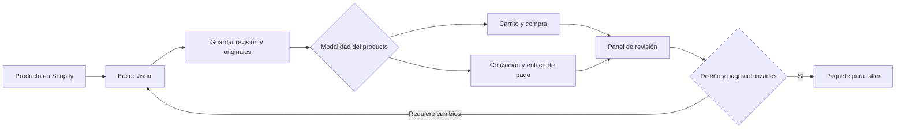

# Personalizador de productos para Souvenir Made

Investigación y especificación inicial. Fecha: 19 de noviembre de 2026.

Estado al cierre de la investigación: no había implementación. La primera versión local se construyó después; ver [estado actual e instalación](../README.md). La app aún no está instalada en Shopify.

## 1. Decisión recomendada

Crear una app de distribución personalizada para la tienda Shopify Basic, con un editor visual 2D, configuración por producto y técnica, y una bandeja de revisión de diseños antes de fabricar.

Decisiones indicadas por el usuario:

- Cubrir todo el catálogo por etapas.
- El equipo revisa y aprueba el diseño antes de fabricar.

La primera versión debe cerrar un recorrido completo: configurar un producto, personalizarlo desde móvil, guardar el diseño, comprar o solicitar cotización, revisar el arte y entregar al taller un paquete verificable. La cobertura del catálogo se amplía después de demostrar ese recorrido con productos reales.

La aprobación técnica del taller es independiente del pago y de la confirmación visual del comprador. Un pedido pagado no queda automáticamente autorizado para producción.

## 2. Qué se investigó y qué no está comprobado

Se consultaron documentación oficial de Shopify, documentación de Zakeke y Kickflip, información de Customily, las fichas de Teeinblue y Qstomizer en Shopify App Store, y documentación técnica de Printful y OWASP. Las funciones comerciales se consideran capacidades declaradas por sus proveedores, no resultados de una prueba propia.

Se extrajo el texto de las 23 páginas del catálogo y se revisaron visualmente sus páginas renderizadas, con ampliaciones de productos representativos. Fuente local: [catálogo Souvenir Made](D:/proyectos/creatiendaya/TRABAJOS/SOUVENIR/Souvenir_Made_Catalogo_Contornos_Corregidos.pdf).

Las capturas del usuario muestran un editor con carga de imágenes, texto, diseños, capas, proyectos, varias vistas y compra por cantidades. Sirven como referencia funcional. No se ha identificado con certeza su proveedor. La URL de la demo visible en la captura no pudo abrirse con la herramienta de investigación; no se afirma haber probado ese editor.

No se ha accedido a la tienda real ni comprobado tema, productos, variantes, stock, aplicaciones instaladas, maquinaria, tarifas o archivos originales. El catálogo presenta ejemplos comerciales; sus imágenes y sus contornos visuales no certifican medidas de fabricación, troqueles ni máscaras técnicas.

En este documento se distinguen hechos de las fuentes, propuestas de diseño y datos pendientes. Los textos comerciales del PDF se usan como información del catálogo, no como instrucciones para enviar mensajes o realizar acciones.

## 3. Referentes y aprendizajes

| Referente | Capacidad documentada relevante | Aplicación propuesta para Souvenir Made |
| --- | --- | --- |
| Customily | Plantillas con parámetros editables, texto e imágenes, límites de posición, opciones condicionales y archivos automáticos | Ofrecer personalización guiada además del editor libre. Preparar plantillas por ocasión y por producto. |
| Zakeke | Organización producto, caras y áreas; métodos de impresión que controlan herramientas y exportación | Separar el producto físico de la técnica que se aplicará. Reutilizar reglas por técnica. |
| Kickflip | Configuración por preguntas, condiciones, imágenes y texto; áreas físicas, sangrado, zona segura e indicador de calidad | Guiar al cliente mediante pasos comprensibles y validar la calidad al tamaño elegido. |
| Teeinblue | Previsualización y generación de archivos de producción, con automatización del flujo de pedidos | Mantener unidos diseño, pedido y salida de producción desde el comienzo. |
| Qstomizer | Editor visual, áreas en varias caras, variantes, cantidades y reglas de precios | Tomar como referencia la experiencia de editar, revisar y comprar varias unidades. |

Fuentes: [Customily: herramientas](https://www.customily.com/our-features), [Zakeke: estructura básica](https://zakeke.zendesk.com/hc/en-us/articles/360016943740-Quick-and-important-infos-to-learn-how-to-use-the-Zakeke-Visual-Product-Customizer), [Kickflip: configuradores](https://help.gokickflip.com/en/articles/4579577-what-you-can-build-with-kickflip), [Kickflip: archivos de impresión](https://help.gokickflip.com/en/articles/5422510-generating-print-ready-files), [Teeinblue](https://apps.shopify.com/teeinblue), [Qstomizer](https://apps.shopify.com/qstomizer).

Conclusión de diseño: conviene adoptar la estructura y los controles de estas herramientas. No es necesario reproducir su catálogo completo de efectos, IA o visualización 3D para lograr un flujo fiable.

## 4. Límites de Shopify Basic que afectan al proyecto

| Necesidad | Situación comprobada | Decisión propuesta |
| --- | --- | --- |
| App exclusiva para una tienda | Shopify admite distribución personalizada a una tienda, sin revisión de App Store | Crear la app desde las herramientas de desarrollo actuales y elegir esa distribución. |
| Editor en la página de producto | Las Theme App Extensions permiten bloques y recursos interactivos en temas compatibles | Añadir el botón Personalizar y abrir el editor desde un bloque. Verificar compatibilidad del tema real. |
| Datos del diseño en el carrito | La Cart API admite propiedades por artículo y varias líneas de una misma variante | Guardar identificador y revisión del diseño; conservar el documento completo en el servidor. |
| Editor dentro de información, envío o pago | Las extensiones de interfaz de esas páginas requieren Plus | Completar la personalización antes del checkout. |
| Shopify Functions en una app custom | Requiere Plus; las apps públicas con Functions tienen otra disponibilidad | La app custom propuesta no dependerá de Functions. |
| Cambiar precio o imagen de una línea con Cart Transform | Las operaciones lineUpdate se restringen a tiendas de desarrollo o Plus | No basar precios ni miniaturas de checkout en esa operación. |
| Cotización y enlace de pago | La API de pedidos preliminares permite crear propuestas y obtener un checkout de pago | Usar este recorrido para trabajos que necesitan cotización. |

Fuentes: [distribución de apps](https://shopify.dev/docs/apps/launch/distribution), [Theme App Extensions](https://shopify.dev/docs/apps/build/online-store/theme-app-extensions), [Cart API](https://shopify.dev/docs/api/ajax/reference/cart), [disponibilidad de checkout](https://help.shopify.com/en/manual/checkout-settings/customize-checkout-configurations/checkout-apps), [Shopify Functions](https://shopify.dev/docs/apps/build/functions), [Cart Transform](https://shopify.dev/docs/api/functions/latest/cart-transform), [pedidos preliminares](https://shopify.dev/docs/api/admin-graphql/latest/mutations/draftOrderCreate).

La app puede mostrar una miniatura personalizada en su editor y en la integración del carrito. Eso no implica que pueda sustituir libremente la imagen nativa del producto en checkout o en todo Shopify.

## 5. Catálogo y requisitos por familia

Las técnicas y ejemplos de esta tabla provienen del catálogo; las funciones son propuestas. Las medidas comerciales mencionadas no sustituyen el área útil que debe confirmar el taller.

| Producto / páginas | Personalización mostrada | Requisitos propuestos |
| --- | --- | --- |
| Portafotos / 2 | Nombre o logo en base de madera | Área estrecha, texto legible y reglas de grabado. |
| Termo / 3 | Láser o DTF | Selección de técnica, vista por color, área acotada y salida por técnica. |
| Llavero / 4 | Placa metálica personalizada | Máscara según placa, tamaño mínimo de texto; confirmar técnica exacta. |
| Termo de sublimación / 5 | Diseño a color | Plantilla plana de impresión y vista sobre el termo; confirmar envolvente y uniones. |
| Gorra con parche / 6 | Parche grabado con láser | Forma, material y área útil del parche; distinguir superficie de la gorra y superficie del parche. |
| Gorra bordada / 7 | Bordado | Ubicación, colores de hilo, restricciones de detalle y paso de ponchado. |
| Bolígrafos de bambú / 8 | Grabado láser | Área larga y angosta, textos cortos, tamaño y orientación restringidos. |
| Vasos de vidrio / 9 | DTF o UV | Transparencia en la vista, colores y fondos; confirmar proceso y necesidad de blanco. |
| Vasos de viaje / 10 | Grabado láser | Máscara específica, acabado del material y escala física. |
| Cuadros / 13 | Foto grabada sobre placa de aproximadamente 12 × 12 pulgadas | Recorte, contraste y revisión de imagen; no asumir conversión fotográfica automática aceptable. |
| Placas de acrílico / 14-17 | UV DTF; ejemplos de logos, familia, boda y XV años, 6 × 4 pulgadas | Plantillas por ocasión, orientación, transparencia y posible contorno especial confirmado por taller. |
| Playeras / 18 | Logo en pecho, bordado o DTF | Modelo, color, talla, ubicación del logo, cantidades por variante y técnica. |
| Polos / 19 | Logo en pecho, bordado o DTF | Mismo motor textil con áreas y precios propios. |
| Camisas / 20 | Logo en pecho, bordado o DTF | Áreas que respeten bolsillo y botones, según modelo. |
| Imanes / 22 | A color, laminados, rectangulares u ovalados | Máscaras por forma, sangrado, zona segura y contorno de corte si aplica. |
| Tarjetas / 23 | Nombre, logo y contacto | Plantilla estructurada; caras, medidas, sangrado y QR solo si se habilitan y validan. |

Las gorras de páginas 11 y 12 son modelos/colores que deben vincularse con variantes y stock reales. La fecha de disponibilidad indicada en el catálogo no se publica automáticamente como inventario disponible.

No se asigna un precio desde el PDF: el catálogo no contiene una tarifa de venta suficiente para automatizar cobros. Tampoco se asume que todas sus fotos sean bases reutilizables del editor: varias ya tienen logos o ilustraciones.

## 6. Funciones del editor del comprador

### Imprescindibles en el primer recorrido

| Función | Comportamiento esperado |
| --- | --- |
| Entrada desde producto | Abrir el producto y su variante correctos. Volver sin perder el diseño. |
| Dos modos | Plantilla guiada para cambiar campos; edición libre limitada al área autorizada cuando el producto lo permita. |
| Texto | Añadir y editar; fuentes autorizadas; tamaño, color, alineación, límites de caracteres y líneas. Soportar ñ y acentos. |
| Imágenes | Subir PNG/JPEG, recortar, rotar y escalar conservando proporciones. Mantener el original separado de la imagen de pantalla. |
| Elementos | Seleccionar, mover, duplicar, eliminar, ordenar capas, centrar y alinear. Bloquear fondo y elementos de plantilla. |
| Correcciones | Deshacer/rehacer y restablecer con confirmación si se pierde trabajo. |
| Área permitida | Mostrar límites; recortar visualmente lo que corresponda y advertir sobre contenido fuera de zona segura. |
| Calidad | Calcular resolución efectiva según tamaño final, incluyendo recorte y ampliación. |
| Variantes | Cambiar modelo/color/talla conservando el arte cuando sea compatible; pedir ajuste si cambia el área. |
| Caras | Mostrar únicamente las configuradas; validar las que sean obligatorias. |
| Guardado | Autoguardado con estado visible, recuperación y versión guardada al continuar. |
| Revisión final | Mostrar todas las caras, técnica, variante, cantidades, importe o estado de cotización y advertencias. |
| Compra | Añadir el diseño guardado al carrito o enviar solicitud de cotización, según configuración del producto. |

Guardar en el dispositivo sirve como recuperación auxiliar. La compra debe apuntar a un diseño persistido en servidor, no depender del almacenamiento local del navegador.

Propuesta inicial de formatos: PNG/JPEG para edición inmediata; SVG sanitizado y archivos PDF como una ampliación controlada o como adjuntos para revisión. Admitir AI, EPS, PSD o CDR en el editor implica conversiones adicionales: no se promete edición fiel solo por permitir subirlos. Incluso herramientas comerciales documentan diferencias de tratamiento entre archivos vectoriales y rasterizados. [Zakeke: tratamiento de archivos](https://zakeke.zendesk.com/hc/en-us/articles/22165944418972-Upload-tool).

### Experiencia móvil y accesibilidad

- Vista del producto suficientemente grande; herramientas en panel inferior o lateral que no tape el elemento seleccionado.
- Controles táctiles y campos numéricos para posicionar y ajustar sin depender de arrastrar con precisión.
- Mantener disponible el precio y la acción de continuar; gestionar el teclado del móvil sin ocultar el texto editado.
- Selección de capas accesible, etiquetas claras, foco de teclado y mensajes que no dependan solo del color.
- Carga con progreso, cancelación y reintento. Conexión interrumpida no debe borrar el trabajo.
- No exigir crear una cuenta para probar o comprar. Recuperación entre dispositivos y proyectos de una cuenta pueden añadirse después.

### Ampliaciones

Texto curvo, biblioteca de diseños por ocasión, QR verificado, eliminación de fondo, nombres distintos por unidad, importación de listas, proyectos compartidos y recompra. La eliminación de fondo debe conservar el original y permitir deshacerla.

3D, realidad aumentada e imágenes generadas con IA quedan para una fase posterior, si hay una necesidad y activos adecuados. Una foto frontal de la gorra no constituye un modelo 3D.

## 7. Panel del comercio

Debe permitir al equipo administrar productos sin editar código:

- Activar productos y vincular variantes de Shopify; detectar variantes eliminadas o sin stock.
- Definir caras y áreas útiles en milímetros o pulgadas; ajustar su posición sobre la foto.
- Definir máscaras, márgenes, sangrado y restricciones por cara.
- Seleccionar técnica y aplicar reglas reutilizables: fuentes, colores, tamaños, carga de imágenes y tipo de exportación.
- Crear y duplicar plantillas; bloquear logotipo/fondo y exponer solo los campos editables.
- Elegir compra directa o cotización; configurar los conceptos de cobro que estén implementados.
- Probar vista móvil/escritorio, guardar borrador y publicar una versión de configuración.
- Buscar pedidos y diseños por identificador; comparar revisiones y descargar archivos.
- Registrar revisiones técnicas, motivos de corrección y autorización para fabricar.
- Registrar errores de carga o exportación con opción de reintento.

Actualizar una plantilla no debe modificar diseños ya comprados ni sus archivos aprobados. Cada compra conserva la versión de plantilla y reglas que se utilizó.

## 8. Flujo de revisión y aprobación

Estados de diseño propuestos:

`Borrador → Enviado → En revisión → Requiere cambios / Aprobado por taller → Listo para producción → En producción → Terminado`

El pago se registra por separado: pendiente, pagado, parcialmente pagado o reembolsado según la información de Shopify. La cotización también tiene su propio estado y vigencia. No conviene mezclar esas tres dimensiones en un único estado.

Dos recorridos comerciales:

1. **Precio cerrado:** personalizar, confirmar la vista, pagar, revisión del taller, aprobación y fabricación.
2. **Trabajo a cotizar:** personalizar o adjuntar idea, indicar cantidad/fecha, revisión técnica, cotización, aceptación y pago, aprobación final y fabricación.

En ambos recorridos:

- El cliente confirma ortografía, imágenes y distribución antes de enviar.
- El taller comprueba tamaño, técnica, legibilidad, calidad y viabilidad del diseño.
- Un ajuste visible exige una nueva revisión del diseño y aceptación del cliente antes de producir. La aceptación previa no se aplica a una versión modificada.
- Registrar quién aprobó, fecha, revisión y archivo correspondiente; las acciones del cliente pueden identificarse mediante sesión o enlace seguro, sin exigir cuenta.
- Solo se autoriza producción cuando coincide la revisión aprobada, existe el paquete correcto y se cumple la política de pago.
- Una corrección posterior a la autorización obliga a detener o revisar expresamente su efecto sobre producción.

El panel debe permitir copiar un enlace seguro para revisión o preparar el texto de contacto. Los envíos automáticos por correo o WhatsApp requieren un canal configurado; no forman parte de esta investigación ni se ha enviado ningún mensaje.

## 9. Archivos y reglas de fabricación

Guardar cuatro elementos diferentes:

| Elemento | Finalidad |
| --- | --- |
| Originales del cliente | Conservar calidad y permitir revisión del arte recibido. |
| Documento editable | Texto, fuentes, posiciones, escalas, recortes, caras y referencias a originales. |
| Vista aprobada | Evidencia visual de lo que vio y aceptó el comprador. |
| Paquete de producción | Arte a escala por área, ficha técnica y archivos específicos aprobados. |

La previsualización sobre una foto puede deformar el diseño para simular perspectiva o curvatura. La salida de producción debe usar las coordenadas del área plana original. No se imprime una captura de la taza, de la gorra ni de las guías del editor.

Reglas propuestas por técnica, sujetas a confirmación del taller:

| Técnica | Controles y entrega |
| --- | --- |
| Sublimación | Medida física, resolución, cobertura y uniones; inversión del arte solo si el flujo del taller lo requiere. |
| DTF / UV DTF / UV | Transparencia, fondos, legibilidad y área; perfiles, blanco y preparación de impresión conforme al equipo/RIP. |
| Láser | Unidades, tamaño, contraste y arte vectorial o imagen según operación; distinguir grabado de corte y material real. |
| Bordado | Colores disponibles, tamaño de letra, grosor de líneas y complejidad; preparar/adjuntar ponchado compatible y revisarlo. |
| Imanes y tarjetas | Tamaño final, sangrado, margen seguro, caras y contorno de corte cuando aplique. |

No hay un único archivo universal para las técnicas del catálogo. Un SVG que contiene una imagen sigue conteniendo píxeles; convertir un JPG en PDF no lo vuelve vectorial. Tampoco aumentar la etiqueta DPI recupera detalle perdido.

Ejemplo matemático, no medida de un producto del catálogo: un área de 100 × 50 mm a 300 píxeles por pulgada requiere aproximadamente 1181 × 591 píxeles. El umbral válido y el sangrado se configuran por proceso; no se fija 300 como requisito universal.

Para bordado, el ponchado convierte el arte en instrucciones de puntadas. No se obtiene un archivo de máquina fiable simplemente exportando el editor a PNG o renombrando el archivo. Printful documenta esa diferencia y la revisión cuando hay ajustes; sus límites o máquinas no se toman como especificación automática de Souvenir Made. [Printful: digitalización](https://help.printful.com/hc/en-us/articles/50264003645073-What-is-embroidery-digitization), [guía de bordado](https://help.printful.com/hc/en-us/articles/50263985175953-How-should-I-prepare-my-design-for-embroidery).

Cada paquete debe identificar pedido, artículo, variante, cantidad, técnica, área, dimensiones, revisión y observaciones. Debe descargarse después de una recarga y poder regenerarse usando los originales y recursos de la revisión comprada.

## 10. Precios, cantidades y carrito

### Estrategia propuesta para Basic

| Estrategia | Uso apropiado | Condición |
| --- | --- | --- |
| Precio de variante que incluye la personalización | Casos de técnica y área estandarizadas | Primera opción para compra directa; mantener stock y variantes coherentes. |
| Pedido preliminar con precio calculado/revisado en servidor | Bordado complejo, volumen, preparación y trabajos especiales | Recorrido de cotización con enlace de pago; verificar descuentos, envío, impuestos y reserva de stock. |
| Artículo adicional de personalización | Extras bien definidos | Solo después de resolver cantidades, eliminación, descuentos y verificación del pedido. No es la opción inicial por defecto. |

En la API actual, los pedidos preliminares permiten usar variantes y también artículos personalizados; existe un campo de ajuste de precio para la línea. Un artículo personalizado sin variante no representa automáticamente el stock del producto físico. La creación de un pedido preliminar tampoco reserva inventario por defecto. [Crear pedidos preliminares](https://shopify.dev/docs/api/admin-graphql/latest/mutations/draftOrderCreate), [campos de línea](https://shopify.dev/docs/api/admin-graphql/latest/input-objects/DraftOrderLineItemInput).

No crear un producto nuevo por cada diseño ni modificar el precio global de una variante para atender una compra individual. El texto del importe mostrado en el editor no determina lo que Shopify cobra.

Un presupuesto puede combinar precio unitario por variante/técnica, cantidad, caras y preparación de arte o ponchado. Los cargos por pedido y por unidad se deben distinguir; una digitalización no debe multiplicarse por el número de prendas sin una regla explícita.

### Integridad de la compra

- Dos diseños diferentes de una misma variante deben permanecer diferenciados; cada uno conserva identificador y revisión.
- Editar desde carrito crea o selecciona otra revisión y actualiza la línea correcta. No se usa solo el identificador de variante para distinguir diseños.
- El cambio de cantidad se vuelve a validar con stock, precio y cotización cuando corresponda.
- Las propiedades privadas con prefijo `_` sirven para ocultación visual; siguen accesibles mediante Liquid y Ajax. No son un mecanismo de seguridad ni un lugar para credenciales.
- El servidor valida que el diseño existe, pertenece a la sesión autorizada y coincide con variante, técnica y reglas de cobro.
- La interfaz del tema puede exigir personalizar, pero una app custom en Basic no debe prometer bloqueo infalible de cualquier compra incompleta mediante JavaScript. Los pedidos inconsistentes se retienen para revisión y no se fabrican; si se necesita impedir también el pago, debe evaluarse un flujo controlado de cotización/pedido preliminar u otra capacidad compatible.

La Cart API documenta tanto líneas con una misma variante y distintas propiedades como la sustitución completa de propiedades al actualizarlas. Se requiere preservar los datos pertinentes al editar. [Cart API](https://shopify.dev/docs/api/ajax/reference/cart).

## 11. Arquitectura inicial propuesta

Componentes:

- App administrativa integrada en Shopify, siguiendo la plantilla oficial y autenticación vigente.
- Theme App Extension para entrada al editor y configuración de presentación.
- Editor con un documento estructurado independiente de su tamaño de pantalla; elegir biblioteca gráfica tras una prueba de texto, imágenes, máscaras y exportación.
- Servicio de servidor para configuraciones, diseños, autorizaciones y cotizaciones.
- Base de datos para referencias y versiones; almacenamiento de objetos para originales, vistas y archivos de salida.
- Proceso de exportación con cola, reintentos y registro de fallos. La generación pesada no debe bloquear una petición de navegación.
- Recepción de eventos de pedidos y conciliación con Shopify; procesamiento idempotente para evitar duplicar diseños o trabajos.

La plantilla React Router es la ruta que Shopify recomienda para la mayoría de apps en la documentación consultada. Un app proxy puede conectar rutas de la tienda con el servidor propio. Son opciones de implementación, no autorización para instalar, desplegar o contratar servicios ahora. [Plantilla oficial](https://shopify.dev/docs/apps/build/scaffold-app), [app proxies](https://shopify.dev/docs/apps/build/online-store/app-proxies).

La elección concreta de proveedor, base de datos y motor de exportación se decide al conocer alojamiento disponible y requisitos del taller. No se necesita una tienda headless para el alcance descrito.

## 12. Fiabilidad, archivos y datos

Requisitos proporcionales a una app que recibe logos y fotos:

- Validar formatos reales y límites de peso, píxeles y complejidad; no confiar únicamente en la extensión del nombre.
- Procesar archivos de forma aislada y sanitizar SVG antes de habilitarlo. Rechazar contenido activo o referencias externas no autorizadas.
- Almacenamiento privado, acceso temporal autorizado y permisos para cada diseño. Un identificador difícil de adivinar no sustituye la autorización.
- Mantener credenciales de Shopify en servidor; limitar permisos a las funciones implementadas.
- Verificar firmas de eventos, tolerar duplicados y reintentar operaciones fallidas.
- Definir retención de borradores y pedidos, borrado solicitado, copias de seguridad y restauración. No eliminar originales de pedidos activos por una limpieza de borradores.
- Fijar versiones de fuente, plantilla y motor de exportación; registrar fallos de recursos para que una fuente ausente no cambie silenciosamente el diseño.
- Descargar imágenes de previsualización reducidas y conservar archivos originales para la salida; cargar el editor bajo demanda.

Fuentes: [OWASP: carga de archivos](https://cheatsheetseries.owasp.org/cheatsheets/File_Upload_Cheat_Sheet.html), [Shopify: verificación de eventos](https://shopify.dev/docs/apps/build/webhooks/verify-deliveries), [datos protegidos](https://shopify.dev/docs/apps/launch/protected-customer-data), [rendimiento del storefront](https://shopify.dev/docs/apps/build/performance/storefront).

Objetivos propuestos para medir en una prueba, no resultados actuales: respuesta de edición fluida con el máximo de elementos autorizado, recuperación tras una interrupción de red, y bajo impacto en páginas sin personalizador. Medir antes y después de instalar con productos y móviles representativos; fijar presupuestos numéricos tras obtener esa línea base.

## 13. Implementación por etapas para cubrir el catálogo

| Etapa | Cobertura | Condición de salida |
| --- | --- | --- |
| 0. Preparación y prueba de fabricación | Seleccionar gorra con parche, termo y producto plano como muestras | Fotos limpias, áreas confirmadas, reglas de precio y prueba de archivo aceptada por taller. Elegir con el equipo el primer producto comercial. |
| 1. Primer recorrido completo | Gorra con parche y/o personalización sencilla con precio cerrado; bandeja de revisión común | Comprar en prueba desde móvil, revisar, aprobar y producir muestra. Sin ponchado automático. |
| 2. Grabado y superficies curvas | Termos, vasos de viaje, bolígrafos, llaveros, base de portafotos y cuadro fotográfico; cotización para casos complejos | Exportaciones y revisión validadas por material y área; prueba específica de foto grabada. |
| 3. Productos a color y planos | Termos de sublimación, vasos de vidrio, acrílicos, imanes y tarjetas | Reglas de transparencia, recorte, sangrado, caras y archivo por proceso verificadas. |
| 4. Textiles y bordado | Gorras bordadas, playeras, polos y camisas | Cantidades por talla/color, gestión de ponchado, revisión técnica y archivo específico vinculados al pedido. |
| 5. Productividad | Todo lo habilitado | Plantillas masivas, recompra, listas de nombres, exportaciones agrupadas y automatizaciones justificadas por uso real. |

Las etapas se organizan por riesgo de fabricación y reutilización del motor; no por una promesa de fechas. Una familia puede adelantarse si ya dispone de activos y proceso más claro. No conviene acumular todos los efectos gráficos antes de validar una compra y una entrega al taller.

## 14. Criterios de aceptación antes de publicar

1. Un comprador diseña desde móvil y escritorio y recupera el trabajo después de recargar.
2. Texto con ñ, tildes y varias líneas coincide entre editor, vista aprobada y salida.
3. El área física exportada coincide con la medida acordada con el taller; las tolerancias se fijan por técnica y se validan en muestra.
4. Una imagen insuficiente dispara advertencia al tamaño final; agrandarla actualiza la advertencia.
5. Un elemento fuera de área no se acepta silenciosamente como imprimible; la máscara se respeta también al exportar.
6. Dos diseños del mismo producto no se mezclan en carrito ni en pedido.
7. Editar un diseño en carrito modifica únicamente el artículo correspondiente y conserva un historial recuperable.
8. Variante agotada o eliminada se resuelve con un mensaje y una elección válida antes de continuar.
9. Precio mostrado, carrito y pago coinciden en los casos habilitados, incluyendo cantidades, descuentos y cargos de preparación.
10. Pedido pagado sin diseño válido queda bloqueado operativamente para fabricación y visible como incidencia.
11. Un evento duplicado o una caída del exportador no crea dos trabajos; el archivo puede reintentarse.
12. Un usuario no puede abrir ni modificar el original o proyecto de otro comprador.
13. Cambiar una plantilla o una fuente después de la compra no altera el archivo aprobado.
14. Una corrección visible necesita nueva aprobación; solo la revisión autorizada pasa al taller.
15. Para bordado se valida el ponchado con el equipo responsable; la vista simulada no lo reemplaza.
16. El paquete de fabricación está identificado por pedido/artículo/revisión y se descarga sin depender de la sesión del comprador.
17. Un fallo de la app ofrece recuperación o solicitud de ayuda/cotización; no pierde silenciosamente el diseño ni autoriza fabricación incompleta.

Validación por tres niveles: lógica de diseños/precios/estados; integración real con carrito, pedido y eventos de Shopify; recorrido completo y muestra física por técnica. Una demo visual por sí sola no cumple estos criterios.

## 15. Datos pendientes y costos a considerar

Antes de cerrar implementación e integración, reunir:

| Dato | Para qué sirve |
| --- | --- |
| Tienda y tema actuales | Preparar una integración compatible y probarla sin afectar ventas. |
| Productos, modelos, colores y tallas reales | Vincular variantes, disponibilidad y fotos correctas. |
| Áreas útiles por modelo y cara | Configurar coordenadas y exportaciones a escala. |
| Fotos originales sin personalización | Construir vistas fieles; el PDF no garantiza estos activos. |
| Equipos, programas y formatos que acepta el taller | Definir salidas, perfiles, blanco, espejo y ponchado. |
| Precios unitarios, preparación, mínimos y descuentos | Elegir compra directa frente a cotización. |
| Momento de cobro y política ante un arte rechazado | Resolver correcciones y pedidos pagados que no pueden fabricarse. |
| Idiomas, moneda y fechas de entrega | Adaptar interfaz y expectativas; confirmar si se necesita español e inglés. |
| Volumen de diseños/pedidos y retención | Dimensionar almacenamiento, exportación y soporte. |

Costo total a evaluar: desarrollo + alojamiento del servidor y base de datos + almacenamiento y transferencia + generación de archivos + respaldos/monitoreo + mantenimiento frente a cambios de Shopify + trabajo de revisión y ponchado. Servicios de IA o mensajería, si se incorporan, añaden costos propios.

No se estiman importes ni plazos de desarrollo sin esos datos. Las tarifas de apps comerciales tampoco demuestran el costo de construir la solución. La elección custom se justifica por control del flujo, propiedad de los datos y adaptación al taller, no por asumir que carecerá de costos recurrentes.

## 16. Alcance inicial que queda preparado

Se recomienda comenzar por la prueba de un producto y un proceso de taller, manteniendo el modelo preparado para todas las familias. La entrega inicial de software debe incluir editor, configuración, guardado, integración de compra o cotización, revisión y paquete de fabricación. El siguiente trabajo es convertir esa prueba en diseño técnico y pantallas, usando los datos pendientes, antes de ampliar el catálogo.

No se han creado credenciales, instalado apps, modificado productos, realizado compras, enviado comunicaciones ni desplegado servicios durante esta investigación.
